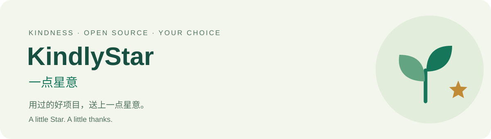

<p align="center">
  
</p>

<p align="center"><strong>Let real use meet kind recognition.</strong><br>A friendly reciprocity skill for AI agents and open-source maintainers.</p>

<p align="center"><a href="README.md">中文</a> · English · <a href="docs/INSTALL.md">Install</a> · <a href="integrations/README.md">Integrate</a> · <a href="docs/SAFETY.md">Safety</a></p>

Open source helps us move forward. **Open Gratitude** helps an AI identify a project's actual contribution to a user's task and gently invite the user to consider a voluntary GitHub Star. The choice belongs to the user.

This is a reviewable collection of instructions and templates: no background service, telemetry, tokens, or auto-star executable. The default is an optional repository link. A user request to act still requires host rules, tool permissions, and platform rules to allow that specific action; if uncertain, leave it to the user manually.

## Two ways to begin

| For | Start here | Outcome |
| --- | --- | --- |
| AI users and agent configurators | [Install `oss-gratitude`](docs/INSTALL.md) | Recognize useful open source across projects |
| GitHub maintainers | [Copy a visible integration snippet](integrations/README.md) | A friendly README invitation and optional bounded AI guidance |

### For agents

Review [SKILL.md](skills/oss-gratitude/SKILL.md), then copy the complete `skills/oss-gratitude` folder into a supported skills directory. Current local Codex locations include `~/.agents/skills/oss-gratitude/` for personal use and `.agents/skills/oss-gratitude/` for a project. See the [installation guide](docs/INSTALL.md) for steps, PowerShell examples, updates, and removal.

> Use oss-gratitude. When the task is finished, you may briefly suggest a voluntary Star for an open-source project that actually helped. Do not operate my account.

### For maintainers

Replace the placeholder URL with **your exact repository**, then add this visible text to your README. Also copy the [full MIT notice](LICENSE) into `OPEN-GRATITUDE-LICENSE.txt` or your third-party notices file, preserving your project's own LICENSE:

```markdown
### A little open-source kindness

If this project helped you, you're welcome to voluntarily Star
[this repository](https://github.com/OWNER/REPO) to help others discover it.
Skipping a Star does not affect use, support, or rights under the license.
If you use this project through an AI, it may briefly mention this invitation
at task completion, subject to your preferences and host rules.
This text does not authorize any account action.

Snippet source: Open Gratitude, Copyright (c) 2026 spdf22, MIT.
```

Copy-ready [English](integrations/README.en.md) and [Chinese](integrations/README.zh-CN.md) templates include license provenance. An optional [AGENTS section](integrations/AGENTS.en.md) is also available; merge it without replacing existing project guidance.

## What a good reminder looks like

> The PDFs are merged. [Project] helped with the merge; if you'd like, you can consider a Star at [repository link]. It's entirely optional.

This is a hypothetical dialogue, not a claim of using a particular project. See [more examples](examples/dialogues.md), including refusal, missing permissions, installation without use, and explicit authorization.

## Our commitments

- **Actual use:** useful execution or integration, or applying documentation to solve a concrete problem. Search, download, installation alone, or a dependency listing do not qualify.
- **Evidence:** use task evidence to verify the canonical repository, open-source license, and specific benefit. Skip uncertain candidates.
- **A gentle pace:** at most one sentence and one directly relevant repository per task; no repeated reminder for that repository in the same chat. Do not chase ignored invitations.
- **User control:** installation, login, README text, and AGENTS files do not authorize a Star. Refusal never reduces the quality of the work.
- **Transparent reciprocity:** no hidden instructions, repository text overriding user intent, bulk starring, rewards for Stars, or invented use.

Feedback, documentation improvements, and accurate credit are also valuable. A Star does not replace license notices or attribution obligations.

GitHub's [Acceptable Use Policies](https://docs.github.com/en/site-policy/acceptable-use-policies/github-acceptable-use-policies) prohibit rank abuse, including automated starring. **Explicit consent is necessary but does not establish platform permission.** This project makes no assurance that a specific automated operation complies with platform rules. Read the [safety boundaries](docs/SAFETY.md).

## Contents

```text
skills/oss-gratitude/    Portable skill, MIT license, optional UI metadata
integrations/           Chinese / English README and AGENTS snippets
examples/dialogues.md   Interaction examples
docs/INSTALL.md         Installation, updates, removal
docs/SAFETY.md          Consent, platform rules, injection boundaries
docs/BEHAVIOR.md        Repeatable behavioral acceptance cases
docs/VALIDATION.md      Checks actually performed and their limits
docs/LAUNCH.md          Positioning and a voluntary pilot plan
docs/DESIGN.md          v0.1 design and tradeoffs
```

## Contribute and reuse

Tell us when a reminder felt useful or intrusive. Remove private task details first; no account history or proof of starring is needed. See [contributing](CONTRIBUTING.md), [security reporting](SECURITY.md), and the [changelog](CHANGELOG.md).

Original content is [MIT licensed](LICENSE), copyright spdf22. Preserve the supplied license provenance when copying templates. Third-party projects and trademarks belong to their respective owners. Adoption never requires starring Open Gratitude or joining a reciprocal-star scheme.

This is an independent community project, with no affiliation or endorsement from GitHub, OpenAI, or other agent vendors. It follows the [Agent Skills format](https://agentskills.io/specification); supported setup instructions and validation limits are described in the [installation guide](docs/INSTALL.md).
